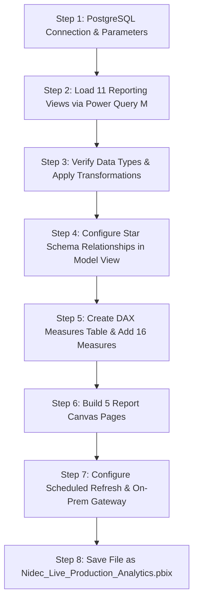

# LIVE PRODUCTION & QUALITY MANAGEMENT SYSTEM
# PHASE 6: POWER BI DESKTOP COMPLETE HANDOFF & IMPLEMENTATION GUIDE

**Document Version**: 2.0  
**Target Audience**: Power BI Developer, Database Administrator, BI Architect  
**Source Database**: `nidec_production_db` (PostgreSQL 16)  
**Reporting Role**: `nidec_reporting_user`  
**Output Target File**: `Nidec_Live_Production_Analytics.pbix`  
**Presentation Reference**: `Live_Production_Quality_System_PowerBI.pptx`  

> [!NOTE]
> **PBIX File Status**: As Power BI Desktop is an interactive desktop application requiring a Windows GUI display environment and is not installed on this headless server CLI, the actual compiled binary `Nidec_Live_Production_Analytics.pbix` report must be created in Power BI Desktop by following the exact steps in this guide. All underlying PostgreSQL views, Power Query M code, and DAX measures are fully compiled and verified.

---

## ORDER OF IMPLEMENTATION WORKFLOW



---

## STEP 1: CONNECTING TO POSTGRESQL & CONFIGURING PARAMETERS

1. Open **Microsoft Power BI Desktop**.
2. Click **Transform data** on the **Home** ribbon to launch the Power Query Editor.
3. In the Power Query ribbon, select **Manage Parameters** -> **New Parameter**:
   - **Parameter 1**:
     - Name: `ServerName`
     - Type: `Text`
     - Suggested Values: `Any value`
     - Current Value: `localhost` (or corporate host `db.internal.nidec.com`)
   - **Parameter 2**:
     - Name: `DatabaseName`
     - Type: `Text`
     - Suggested Values: `Any value`
     - Current Value: `nidec_production_db`
4. When prompted for database credentials by Power BI:
   - Select **Database** authentication (Username and Password).
   - User name: `nidec_reporting_user`
   - Password: Enter the password provisioned from corporate IT Vault / `NIDEC_REPORTING_PASSWORD`.
   - Select Encryption level: `Prefer` or `Require` based on internal company network policy.

---

## STEP 2 & 3: LOADING ALL 11 REPORTING VIEWS VIA POWER QUERY M

In the Power Query Editor, create each query using the **Advanced Editor** (`Home` -> **New Source** -> **Blank Query** -> **Advanced Editor**):

### 1. Dimension Queries:
- **`vw_dim_date`**: Copy M script from `powerbi/power_query/phase6_power_query.m` (lines 14–34).
- **`vw_dim_machine`**: Copy M script (lines 37–52).
- **`vw_dim_customer`**: Copy M script (lines 55–71).
- **`vw_dim_frame`**: Copy M script (lines 74–89).
- **`vw_dim_shift`**: Copy M script (lines 92–108).
- **`vw_dim_personnel`**: Copy M script (lines 111–128).
- **`vw_dim_defect_category`**: Copy M script (lines 131–143).
- **`vw_dim_severity`**: Copy M script (lines 146–159).

### 2. Fact Queries:
- **`vw_fact_production`**: Copy M script (lines 167–208).
- **`vw_fact_quality_nc`**: Copy M script (lines 211–254).
- **`vw_fact_rework`**: Copy M script (lines 257–286).

Click **Close & Apply** on the Home ribbon to load all tables into the Power BI data model.

---

## STEP 4: CONFIGURING STAR SCHEMA RELATIONSHIPS

Switch to **Model View** (left navigation bar, third icon). Configure the following relationships by dragging the primary key to the foreign key:

| From Table (Dimension) | From Key | To Table (Fact) | To Key | Cardinality | Cross filter direction | Active? |
| :--- | :--- | :--- | :--- | :--- | :--- | :--- |
| `vw_dim_date` | `date_key` | `vw_fact_production` | `date_key` | 1 to Many ($1:*$) | Single | Yes |
| `vw_dim_date` | `date_key` | `vw_fact_quality_nc` | `date_key` | 1 to Many ($1:*$) | Single | Yes |
| `vw_dim_date` | `date_key` | `vw_fact_rework` | `date_key` | 1 to Many ($1:*$) | Single | Yes |
| `vw_dim_machine` | `machine_key` | `vw_fact_production` | `machine_key` | 1 to Many ($1:*$) | Single | Yes |
| `vw_dim_machine` | `machine_key` | `vw_fact_quality_nc` | `machine_key` | 1 to Many ($1:*$) | Single | Yes |
| `vw_dim_machine` | `machine_key` | `vw_fact_rework` | `machine_key` | 1 to Many ($1:*$) | Single | Yes |
| `vw_dim_customer` | `customer_key` | `vw_fact_production` | `customer_key` | 1 to Many ($1:*$) | Single | Yes |
| `vw_dim_frame` | `frame_key` | `vw_fact_production` | `frame_key` | 1 to Many ($1:*$) | Single | Yes |
| `vw_dim_shift` | `shift_key` | `vw_fact_production` | `shift_key` | 1 to Many ($1:*$) | Single | Yes |
| `vw_dim_personnel` | `user_key` | `vw_fact_production` | `operator_key` | 1 to Many ($1:*$) | Single | Yes |
| `vw_dim_personnel` | `user_key` | `vw_fact_production` | `supervisor_key` | 1 to Many ($1:*$) | Single | No (Inactive) |
| `vw_dim_defect_category` | `category_name` | `vw_fact_quality_nc` | `defect_category` | 1 to Many ($1:*$) | Single | Yes |
| `vw_dim_severity` | `severity_name` | `vw_fact_quality_nc` | `severity` | 1 to Many ($1:*$) | Single | Yes |
| `vw_fact_quality_nc` | `nc_key` | `vw_fact_rework` | `nc_key` | 1 to Many ($1:*$) | Single | Yes |

*Sort Column Rule*: Set `vw_dim_date[month_name]` to sort by `vw_dim_date[month_number]`.

---

## STEP 5: CREATING THE DAX MEASURES TABLE

1. On the **Home** ribbon, click **Enter Data**. Name the table `_Measures` and click **Load**.
2. For each measure below, click **New Measure** on the **Modeling** ribbon and paste from `powerbi/dax/phase6_dax_measures.dax`:

### Production Measures:
```dax
Total Production Runs = COUNTROWS('vw_fact_production')

Approved Production Runs = CALCULATE([Total Production Runs], 'vw_fact_production'[is_approved] = 1)

Pending Production Runs = CALCULATE([Total Production Runs], 'vw_fact_production'[is_pending] = 1)

Rejected Production Runs = CALCULATE([Total Production Runs], 'vw_fact_production'[is_rejected] = 1)

Average Cycle Time = AVERAGE('vw_fact_production'[cycle_time_hours])

Total Testing Hours = DIVIDE(SUM('vw_fact_production'[total_testing_time_minutes]), 60.0, BLANK())

Production Pass Rate = DIVIDE(CALCULATE([Total Production Runs], 'vw_fact_production'[is_pass] = 1), [Total Production Runs], BLANK())
```

### Quality & NC Measures:
```dax
Total Non-Conformances = COUNTROWS('vw_fact_quality_nc')

Open NCs = CALCULATE([Total Non-Conformances], 'vw_fact_quality_nc'[is_closed] = 0)

Closed NCs = CALCULATE([Total Non-Conformances], 'vw_fact_quality_nc'[is_closed] = 1)

NC Rate = DIVIDE([Total Non-Conformances], [Total Production Runs], BLANK())
```

### Rework Measures (No Double-Counting):
```dax
Total Rework Minutes = SUM('vw_fact_rework'[rework_minutes])

Average Rework Time = AVERAGE('vw_fact_rework'[rework_minutes])
```

### Machine Performance & Trend Measures:
```dax
Machine-wise Production = CALCULATE([Total Production Runs])

Machine-wise Pass Rate = [Production Pass Rate]

Monthly Production Growth = 
VAR CurrentRuns = [Total Production Runs]
VAR PriorMonthRuns = CALCULATE([Total Production Runs], DATEADD('vw_dim_date'[full_date], -1, MONTH))
RETURN
    DIVIDE(CurrentRuns - PriorMonthRuns, PriorMonthRuns, BLANK())
```

Format `Production Pass Rate`, `NC Rate`, and `Monthly Production Growth` as **Percentage (`0.0%`)**. Format `Average Cycle Time` as **Decimal Number (`0.00`)**.

---

## STEP 6: BUILDING THE FIVE REPORT PAGES (FROM ORIGINAL PPT)

### Global Layout & Slicers (All Pages):
- **Header Banner**: Dark industrial blue (`#1E3A8A`) background with title: `Nidec Live Production & Quality Analytics`.
- **Top Filter Slicers**:
  1. `Date Range` Slicer: `vw_dim_date[full_date]` (Between style).
  2. `Machine` Slicer: `vw_dim_machine[machine_name]` (Dropdown style).
  3. `Shift` Slicer: `vw_dim_shift[shift_name]` (Tile/Pill style).
  4. `Customer` Slicer: `vw_dim_customer[customer_name]` (Dropdown style).

---

### PAGE 1: MANAGEMENT OVERVIEW
1. **Top KPI Scorecard Band** (5 KPI visual cards):
   - Card 1: `[Total Production Runs]`
   - Card 2: `[Average Cycle Time]` (hrs)
   - Card 3: `[Production Pass Rate]` (%)
   - Card 4: `[Total Non-Conformances]`
   - Card 5: Calculation `DIVIDE([Total Rework Minutes], 60)` -> Title: "Total Rework Hours"
2. **Monthly Production vs. NC Rate Trend (Line & Clustered Column Chart)**:
   - X-Axis: `vw_dim_date[year_month]`
   - Column Y-Axis: `[Total Production Runs]`
   - Line Y-Axis: `[NC Rate]`
3. **Production NC Status Breakdown (Donut Chart)**:
   - Legend: `vw_fact_quality_nc[status]`
   - Values: `[Total Non-Conformances]`
4. **Approval Workflow Distribution (Stacked Bar Chart)**:
   - Y-Axis: `vw_dim_shift[shift_name]`
   - X-Axis: `[Approved Production Runs]`, `[Pending Production Runs]`, `[Rejected Production Runs]`

---

### PAGE 2: PRODUCTION ANALYSIS
1. **Machines Tested per Month (Clustered Column Chart)**:
   - X-Axis: `vw_dim_date[month_name]`
   - Y-Axis: `[Total Production Runs]`
   - Data labels: On
2. **Average Cycle Time by Month (Line Chart)**:
   - X-Axis: `vw_dim_date[month_name]`
   - Y-Axis: `[Average Cycle Time]`
   - Analytics Line: Add Constant Line at 1.50 Hours (Benchmark Target).
3. **Machine-Wise Output (Horizontal Bar Chart)**:
   - Y-Axis: `vw_dim_machine[machine_name]`
   - X-Axis: `[Machine-wise Production]`
4. **Shift-Wise Distribution (Treemap)**:
   - Category: `vw_dim_shift[shift_name]`
   - Values: `[Total Production Runs]`
5. **Month-over-Month Output Growth (Card)**:
   - Measure: `[Monthly Production Growth]`

---

### PAGE 3: TESTING TIME ANALYSIS
1. **Testing Stage Duration Breakdown (100% Stacked Bar Chart)**:
   - Y-Axis: `vw_dim_machine[machine_code]`
   - X-Axis Values (Average):
     - `vw_fact_production[static_time_minutes]`
     - `vw_fact_production[mounting_time_minutes]`
     - `vw_fact_production[rotational_time_minutes]`
     - `vw_fact_production[dismantling_time_minutes]`
2. **Stage Average Summary Cards (4 Cards)**:
   - Static: `AVERAGE(vw_fact_production[static_time_minutes])` min
   - Mounting: `AVERAGE(vw_fact_production[mounting_time_minutes])` min
   - Rotational: `AVERAGE(vw_fact_production[rotational_time_minutes])` min
   - Dismantling: `AVERAGE(vw_fact_production[dismantling_time_minutes])` min
3. **Stage-Wise Share Distribution (Pie Chart)**:
   - Legend: Testing Stages
   - Values: Sum of testing minutes
4. **Duration vs. Rework Scatter Plot**:
   - X-Axis: `vw_fact_production[total_testing_time_minutes]`
   - Y-Axis: `vw_fact_production[rework_time_minutes]`
   - Details: `vw_fact_production[production_run_key]`

---

### PAGE 4: QUALITY AND NC ANALYSIS
1. **Defect Category Pareto (Clustered Column + Line Chart)**:
   - X-Axis: `vw_dim_defect_category[category_name]`
   - Column Y-Axis: `[Total Non-Conformances]`
   - Line Y-Axis: Running percentage of defects
2. **Severity Distribution (Donut Chart)**:
   - Legend: `vw_dim_severity[severity_name]`
   - Values: `[Total Non-Conformances]`
   - Slice Colors: Critical (Red), Major (Amber), Medium (Yellow), Minor (Gray)
3. **NCs Raised per Month Trend (Area Chart)**:
   - X-Axis: `vw_dim_date[year_month]`
   - Y-Axis: `[Total Non-Conformances]`
4. **Rework Labor Minutes by Department (Bar Chart)**:
   - Y-Axis: `vw_fact_quality_nc[responsible_department]`
   - X-Axis: `[Total Rework Minutes]`
5. **NC Resolution & CAPA Detail (Matrix/Table Visual)**:
   - Columns: `nc_number`, `nc_date`, `machine_code`, `defect_category`, `severity`, `status`, `resolution_duration_hours`, `root_cause`, `corrective_action`

---

### PAGE 5: PRODUCT AND CUSTOMER MIX
1. **Tests by Customer (Horizontal Bar Chart)**:
   - Y-Axis: `vw_dim_customer[customer_name]`
   - X-Axis: `[Total Production Runs]`
2. **Tests by Frame Profile (Donut Chart)**:
   - Legend: `vw_dim_frame[frame_name]`
   - Values: `[Total Production Runs]`
3. **Average Cycle Time by Frame Profile (Column Chart)**:
   - X-Axis: `vw_dim_frame[frame_code]`
   - Y-Axis: `[Average Cycle Time]`
4. **Customer Quality Matrix (Matrix Visual)**:
   - Rows: `vw_dim_customer[customer_name]`
   - Columns / Values: `[Total Production Runs]`, `[Production Pass Rate]`, `[Total Non-Conformances]`, `[NC Rate]`, `[Total Rework Minutes]`

---

## STEP 7: CONFIGURE REFRESH & GATEWAY
1. Publish report to the target workspace in **Power BI Service** (`File` -> **Publish** -> **Publish to Power BI**).
2. In Power BI Service, navigate to **Dataset Settings** -> **Gateway Connection**.
3. Map the dataset to the **Standard On-Premises Data Gateway** configured in `docs/phase6_powerbi_connection.md`.
4. Under **Scheduled Refresh**, enable daily refresh slots at `06:30`, `14:30`, and `22:30` (matching shift turnovers).

---

## STEP 8: SAVE REPORT ARTIFACT
Click **File** -> **Save As** and save the completed workbook as:
```
Nidec_Live_Production_Analytics.pbix
```
Commit or archive the file into the corporate BI repository.
