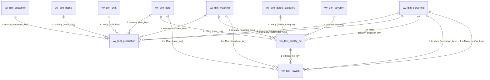

# LIVE PRODUCTION & QUALITY MANAGEMENT SYSTEM
# PHASE 6: POWER BI STAR SCHEMA DATA MODEL & ARCHITECTURE SPECIFICATION

**Document Version**: 1.0  
**Status**: APPROVED & IMPLEMENTED  
**Target Engine**: PostgreSQL 16 / Microsoft Power BI VertiPaq & DirectQuery  
**Database**: `nidec_production_db`  
**Security Role**: `nidec_reporting_user`  

---

## 1. Executive Architecture Overview

The Live Production & Quality Management System analytics architecture transitions the enterprise from fragmented Excel files to a high-performance **Star Schema** powered by PostgreSQL 16 reporting views.

### Architectural Principles:
1. **Zero Data Duplication**: Power BI does not ingest copies of raw transactional tables. It reads from compiled SQL reporting views (`vw_fact_*` and `vw_dim_*`) that calculate metrics and surrogate keys on the fly.
2. **Isolation & Non-Destructive Operation**: Operational transactions (motor testing data entry, supervisor approvals, NC resolution workflows) are never blocked or altered by reporting queries.
3. **Optimized for VertiPaq & DirectQuery**: 
   - All dates are keyed via integer surrogate keys (`YYYYMMDD`).
   - Categorical dimensions are pre-joined with descriptions and hierarchies.
   - Statuses are provided both as textual descriptors and 1/0 integer indicator flags for lightning-fast DAX aggregation.
4. **Least-Privilege Security**: Reports connect using a dedicated read-only role (`nidec_reporting_user`) with permissions strictly limited to the `SELECT` of reporting views. Operational tables, credentials, and audit logs are inaccessible.

---

## 2. Star Schema Entity-Relationship Diagram

---

## 3. Data Dictionary: Fact Views

### 3.1 `vw_fact_production`
- **Grain**: One record per physical motor testing run.
- **Underlying Table**: `production_records`.

| Column Name | SQL Type | Power BI Type | Role / Description |
| :--- | :--- | :--- | :--- |
| `production_run_key` | `INTEGER` | `Int64` | Primary Key (`production_records.id`) |
| `date_key` | `INTEGER` | `Int64` | Foreign Key to `vw_dim_date` (`YYYYMMDD`) |
| `production_date` | `DATE` | `Date` | Production execution calendar date |
| `machine_key` | `INTEGER` | `Int64` | Foreign Key to `vw_dim_machine` |
| `frame_key` | `INTEGER` | `Int64` | Foreign Key to `vw_dim_frame` |
| `shift_key` | `INTEGER` | `Int64` | Foreign Key to `vw_dim_shift` |
| `customer_key` | `INTEGER` | `Int64` | Foreign Key to `vw_dim_customer` |
| `operator_key` | `INTEGER` | `Int64` | Foreign Key to `vw_dim_personnel` (Operator) |
| `supervisor_key` | `INTEGER` | `Int64` | Foreign Key to `vw_dim_personnel` (Supervisor) |
| `approved_by_key` | `INTEGER` | `Int64` | Foreign Key to `vw_dim_personnel` (Approver) |
| `static_time_minutes` | `DOUBLE` | `Decimal` | Duration of static electrical test (min) |
| `mounting_time_minutes` | `DOUBLE` | `Decimal` | Duration of dyno rig motor mounting (min) |
| `rotational_time_minutes` | `DOUBLE` | `Decimal` | Duration of dynamic rotational test (min) |
| `dismantling_time_minutes`| `DOUBLE` | `Decimal` | Duration of motor de-rigging (min) |
| `total_testing_time_minutes` | `DOUBLE` | `Decimal` | Sum of all testing stages ($S+M+R+D$) |
| `cycle_time_hours` | `DOUBLE` | `Decimal` | Total testing cycle time in hours ($\text{Total}/60.0$) |
| `rework_time_minutes` | `DOUBLE` | `Decimal` | Total rework duration associated with test run |
| `test_result` | `VARCHAR` | `Text` | Test outcome: `PASS` or `FAIL` |
| `approval_status` | `VARCHAR` | `Text` | Approval status: `APPROVED`, `PENDING`, `REJECTED` |
| `is_pass` | `INTEGER` | `Int64` | Indicator flag (1 if PASS, 0 otherwise) |
| `is_fail` | `INTEGER` | `Int64` | Indicator flag (1 if FAIL, 0 otherwise) |
| `is_nc_raised` | `INTEGER` | `Int64` | Indicator flag (1 if NC raised, 0 otherwise) |
| `is_approved` | `INTEGER` | `Int64` | Indicator flag (1 if APPROVED, 0 otherwise) |
| `is_pending` | `INTEGER` | `Int64` | Indicator flag (1 if PENDING, 0 otherwise) |
| `is_rejected` | `INTEGER` | `Int64` | Indicator flag (1 if REJECTED, 0 otherwise) |
| `created_at` | `TIMESTAMP` | `DateTimeZone` | Record creation timestamp |
| `updated_at` | `TIMESTAMP` | `DateTimeZone` | Record modification timestamp |

---

### 3.2 `vw_fact_quality_nc`
- **Grain**: One record per formal Non-Conformance (NC) ticket.
- **Underlying Tables**: `nc_records` joined with `quality_records` and `production_records`.

| Column Name | SQL Type | Power BI Type | Role / Description |
| :--- | :--- | :--- | :--- |
| `nc_key` | `INTEGER` | `Int64` | Primary Key (`nc_records.id`) |
| `nc_number` | `VARCHAR` | `Text` | Unique NC code (e.g., `NC-2026-0001`) |
| `production_run_key` | `INTEGER` | `Int64` | Foreign Key to `vw_fact_production` |
| `quality_record_key` | `INTEGER` | `Int64` | Key to source `quality_records` observation |
| `date_key` | `INTEGER` | `Int64` | Foreign Key to `vw_dim_date` (`YYYYMMDD`) |
| `nc_date` | `DATE` | `Date` | Ticket date of occurrence |
| `machine_key` | `INTEGER` | `Int64` | Foreign Key to `vw_dim_machine` |
| `customer_key` | `INTEGER` | `Int64` | Foreign Key to `vw_dim_customer` |
| `frame_key` | `INTEGER` | `Int64` | Foreign Key to `vw_dim_frame` |
| `shift_key` | `INTEGER` | `Int64` | Foreign Key to `vw_dim_shift` |
| `quality_engineer_key` | `INTEGER` | `Int64` | Foreign Key to `vw_dim_personnel` (Assignee) |
| `closed_by_key` | `INTEGER` | `Int64` | Foreign Key to `vw_dim_personnel` (Closer) |
| `title` | `VARCHAR` | `Text` | NC summary title |
| `defect_category` | `VARCHAR` | `Text` | Foreign Key to `vw_dim_defect_category` |
| `severity` | `VARCHAR` | `Text` | Foreign Key to `vw_dim_severity` |
| `responsible_department`| `VARCHAR` | `Text` | Responsible department (Winding, Assembly, etc.) |
| `status` | `VARCHAR` | `Text` | Status: `OPEN`, `IN_PROGRESS`, `UNDER_REVIEW`, `CLOSED` |
| `is_open` | `INTEGER` | `Int64` | 1 if OPEN, 0 otherwise |
| `is_in_progress` | `INTEGER` | `Int64` | 1 if IN_PROGRESS, 0 otherwise |
| `is_under_review` | `INTEGER` | `Int64` | 1 if UNDER_REVIEW, 0 otherwise |
| `is_closed` | `INTEGER` | `Int64` | 1 if CLOSED, 0 otherwise |
| `resolution_duration_hours` | `DOUBLE` | `Decimal` | Hours between creation and closure |
| `logged_rework_minutes`| `DOUBLE` | `Decimal` | Initial estimated rework duration (min) |
| `root_cause` | `TEXT` | `Text` | Documented 5-Why root cause |
| `corrective_action` | `TEXT` | `Text` | Remedial action applied to physical motor |
| `preventive_action` | `TEXT` | `Text` | Process modification to prevent recurrence |
| `closure_notes` | `TEXT` | `Text` | Verification remarks logged by QE upon closure |
| `created_at` | `TIMESTAMP` | `DateTimeZone` | NC ticket creation timestamp |
| `closed_at` | `TIMESTAMP` | `DateTimeZone` | NC verification and closure timestamp |

---

### 3.3 `vw_fact_rework`
- **Grain**: One record per rework task executed.
- **Underlying Table**: `rework_records`.

| Column Name | SQL Type | Power BI Type | Role / Description |
| :--- | :--- | :--- | :--- |
| `rework_key` | `INTEGER` | `Int64` | Primary Key (`rework_records.id`) |
| `nc_key` | `INTEGER` | `Int64` | Foreign Key to `vw_fact_quality_nc` |
| `production_run_key` | `INTEGER` | `Int64` | Foreign Key to `vw_fact_production` |
| `machine_key` | `INTEGER` | `Int64` | Foreign Key to `vw_dim_machine` |
| `date_key` | `INTEGER` | `Int64` | Foreign Key to `vw_dim_date` (`YYYYMMDD`) |
| `rework_date` | `DATE` | `Date` | Date repair work performed |
| `technician_key` | `INTEGER` | `Int64` | Foreign Key to `vw_dim_personnel` (Technician) |
| `verifier_key` | `INTEGER` | `Int64` | Foreign Key to `vw_dim_personnel` (Verifier) |
| `rework_minutes` | `DOUBLE` | `Decimal` | Repair duration in minutes |
| `rework_hours` | `DOUBLE` | `Decimal` | Repair duration in hours ($\text{Minutes}/60.0$) |
| `rework_status` | `VARCHAR` | `Text` | Status: `PENDING`, `COMPLETED` |
| `rework_description` | `TEXT` | `Text` | Detailed description of rework labor performed |
| `is_completed` | `INTEGER` | `Int64` | 1 if COMPLETED, 0 otherwise |
| `is_verified` | `INTEGER` | `Int64` | 1 if verified by supervisor/QE, 0 otherwise |
| `created_at` | `TIMESTAMP` | `DateTimeZone` | Record creation timestamp |
| `updated_at` | `TIMESTAMP` | `DateTimeZone` | Record modification timestamp |

---

## 4. Data Dictionary: Dimension Views

| Dimension View | Grain / Key | Key Attributes | Hierarchy |
| :--- | :--- | :--- | :--- |
| **`vw_dim_date`** | 1 row per calendar day (`date_key` PK) | `full_date`, `calendar_year`, `calendar_quarter`, `quarter_name`, `month_name`, `month_number`, `year_month`, `day_of_month`, `day_name`, `day_of_week`, `is_weekend` | Year $\to$ Quarter $\to$ Month $\to$ Day |
| **`vw_dim_machine`** | 1 row per test rig (`machine_key` PK) | `machine_code`, `machine_name`, `model`, `line_name`, `is_active` | Line Name $\to$ Machine Name |
| **`vw_dim_customer`** | 1 row per client (`customer_key` PK) | `customer_code`, `customer_name`, `contact_person`, `email`, `phone`, `is_active` | Flat Dimension |
| **`vw_dim_frame`** | 1 row per motor frame size (`frame_key` PK) | `frame_code`, `frame_name`, `description`, `is_active` | Flat Dimension |
| **`vw_dim_shift`** | 1 row per shift (`shift_key` PK) | `shift_name`, `start_time`, `end_time`, `shift_window`, `description`, `is_active` | Flat Dimension |
| **`vw_dim_personnel`** | 1 row per user (`user_key` PK) | `username`, `full_name`, `email`, `role_name`, `department`, `is_active`, `is_ad_user` | Department $\to$ Role $\to$ Personnel |
| **`vw_dim_defect_category`**| 1 row per defect category (`category_name` PK) | `category_name`, `primary_domain` (Electrical, Mechanical, Structural, Assembly) | Domain $\to$ Category Name |
| **`vw_dim_severity`** | 1 row per severity rank (`severity_name` PK) | `severity_name`, `severity_rank` (1 to 5), `priority_tier` (High, Medium, Low) | Priority Tier $\to$ Severity Name |

---

## 5. Relationship Cardinality & Filter Directions

| From Table (Dimension) | From Field | To Table (Fact) | To Field | Cardinality | Cross-Filter Direction |
| :--- | :--- | :--- | :--- | :--- | :--- |
| `vw_dim_date` | `date_key` | `vw_fact_production` | `date_key` | 1 to Many ($1:*$) | Single (Dimension filters Fact) |
| `vw_dim_date` | `date_key` | `vw_fact_quality_nc` | `date_key` | 1 to Many ($1:*$) | Single (Dimension filters Fact) |
| `vw_dim_date` | `date_key` | `vw_fact_rework` | `date_key` | 1 to Many ($1:*$) | Single (Dimension filters Fact) |
| `vw_dim_machine` | `machine_key` | `vw_fact_production` | `machine_key` | 1 to Many ($1:*$) | Single (Dimension filters Fact) |
| `vw_dim_machine` | `machine_key` | `vw_fact_quality_nc` | `machine_key` | 1 to Many ($1:*$) | Single (Dimension filters Fact) |
| `vw_dim_machine` | `machine_key` | `vw_fact_rework` | `machine_key` | 1 to Many ($1:*$) | Single (Dimension filters Fact) |
| `vw_dim_customer` | `customer_key` | `vw_fact_production` | `customer_key` | 1 to Many ($1:*$) | Single (Dimension filters Fact) |
| `vw_dim_frame` | `frame_key` | `vw_fact_production` | `frame_key` | 1 to Many ($1:*$) | Single (Dimension filters Fact) |
| `vw_dim_shift` | `shift_key` | `vw_fact_production` | `shift_key` | 1 to Many ($1:*$) | Single (Dimension filters Fact) |
| `vw_dim_personnel` | `user_key` | `vw_fact_production` | `operator_key` | 1 to Many ($1:*$) | Single (Active) |
| `vw_dim_personnel` | `user_key` | `vw_fact_production` | `supervisor_key` | 1 to Many ($1:*$) | Single (Inactive) |
| `vw_dim_defect_category`| `category_name`| `vw_fact_quality_nc`| `defect_category` | 1 to Many ($1:*$) | Single (Dimension filters Fact) |
| `vw_dim_severity` | `severity_name` | `vw_fact_quality_nc` | `severity` | 1 to Many ($1:*$) | Single (Dimension filters Fact) |
| `vw_fact_quality_nc` | `nc_key` | `vw_fact_rework` | `nc_key` | 1 to Many ($1:*$) | Single (NC filters Rework) |

